<p align="center">
  
</p>

# COMPTE-RENDU DE TRAVAUX PRATIQUES (TP) : BUREAU À DISTANCE SÉCURISÉ (RDP & VNC VIA TUNNEL SSH)

| Champ | Détail |
| :--- | :--- |
| **Étudiant** | Ehi Diamhen Winter |
| **Classe** | Licence 3 GLSI (Année Universitaire 2026-2027) |
| **Établissement** | École Supérieure Polytechnique (ESP) — UCAD / Département Génie Informatique |
| **Matière** | Services Réseaux Avancés |
| **Enseignant** | Dr. GUEYE |

---

## 1. Objectif, Principe du Tunnel SSH et Architecture Réseau

L'administration graphique à distance permet d'afficher et de contrôler l'environnement de bureau complet (écran, clavier et souris) d'un serveur Linux depuis un poste client Windows 10. Dans ce travail pratique, deux protocoles complémentaires ont été déployés et sécurisés :

* **Protocole RDP (Remote Desktop Protocol) :** Mise en place du serveur `xrdp` sur la machine virtuelle Ubuntu (port TCP `3389`) et connexion depuis le client natif **Connexion Bureau à distance (`mstsc`)** de Windows 10.
* **Protocole VNC (Virtual Network Computing) :** Déploiement du serveur `TigerVNC` (affichage `:2`, port TCP `5902`) associé à l'environnement de bureau léger **XFCE4** sur Ubuntu, et accès graphique via **TigerVNC Viewer** sous Windows 10.
* **Sécurisation par Tunnel SSH (`ssh -L`) :** Aucun port graphique (ni `3389` ni `5902`) n'est exposé directement sur le réseau local. Tous les flux graphiques transitent à l'intérieur d'un tunnel SSH chiffré ouvert depuis le client Windows vers le serveur Ubuntu.

> **Principe de fonctionnement de la redirection de port local (`ssh -L`) :**  
> La commande `ssh -L port_local:127.0.0.1:port_distant ehiwinter@192.168.1.16` établit une connexion SSH authentifiée depuis Windows et redirige tout trafic arrivant sur le port local de Windows vers l'interface de bouclage (`127.0.0.1`) du serveur Ubuntu.  
> **Règle essentielle :** Le tunnel SSH doit toujours être lancé depuis le poste client Windows (CMD ou PowerShell), jamais depuis la session distante Ubuntu.

### 1.1. Architecture matérielle et logicielle mise en place

| Rôle | Système d'exploitation | Nom d'hôte | Utilisateur | Adresse IP & Services |
| :--- | :--- | :--- | :--- | :--- |
| **Poste Client** | Windows 10 Pro (Machine physique) | `DESKTOP-KOLK3MG` | `HP` | `192.168.1.7` / `192.168.1.8` — Client SSH, `mstsc`, TigerVNC Viewer |
| **Machine Serveur** | Ubuntu 26.04.1 LTS (VM VirtualBox en pont) | `winbuntu` | `ehiwinter` | `192.168.1.16/24` (`enp0s3`) — `openssh-server` (22), `xrdp` (3389), `Xtigervnc` (5902) |

---

## 2. Partie 1 : Bureau à distance RDP avec `xrdp` et Tunnel SSH

### 2.1. Étape 1 — Installation du serveur `xrdp` sur Ubuntu (`winbuntu`)
Ubuntu ne disposant pas nativement d'un serveur compatible avec le protocole RDP de Microsoft, nous installons le paquet `xrdp` (qui installe également `xorgxrdp` pour gérer la session graphique X11).

```bash
sudo apt update
sudo apt install xrdp -y
```

* **Figure 1.1 : Installation du paquet `xrdp` (`0.10.1-4.1ubuntu0.1`) sur le serveur Ubuntu `winbuntu`**  
  *Ce que montre cette capture :* Le gestionnaire de paquets APT télécharge et installe `xrdp`, puis génère automatiquement la paire de clés RSA 2048 bits servant au chiffrement de la session RDP.  
  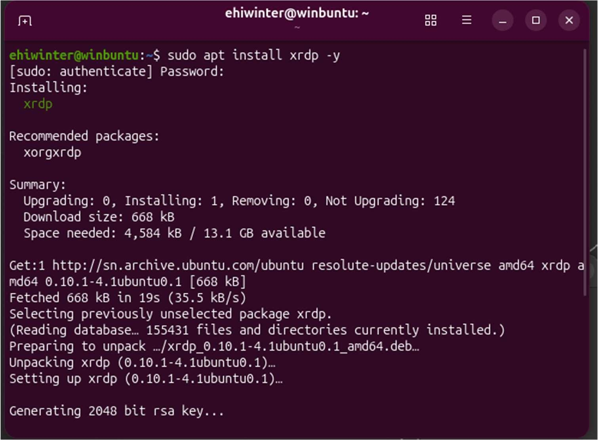

---

### 2.2. Étape 2 — Activation du service, permissions SSL et écoute sur le port 3389
Nous activons le démarrage automatique du démon `xrdp`, nous ajoutons l'utilisateur système `xrdp` au groupe `ssl-cert` afin qu'il puisse accéder à la clé privée TLS du système, puis nous redémarrons le service et vérifions l'ouverture du port TCP `3389`.

```bash
sudo systemctl enable --now xrdp
sudo adduser xrdp ssl-cert
sudo systemctl restart xrdp
sudo ss -tlnp | grep 3389
```

* **Figure 1.2 : Démarrage du service `xrdp` et vérification de l'écoute sur le port TCP 3389 (`ss -tlnp`)**  
  *Ce que montre cette capture :* La commande `ss -tlnp` confirme que le processus `xrdp` (PID `8197`) est actif en état `LISTEN` sur `*:3389`.  
  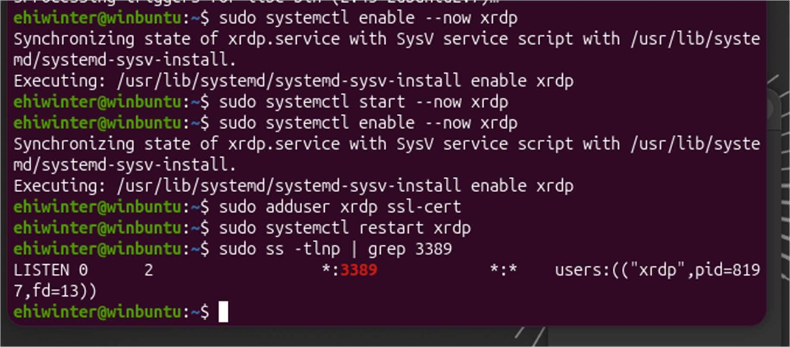

---

### 2.3. Étape 3 — Identification de l'adresse IP locale de la VM Ubuntu
La carte réseau VirtualBox étant configurée en mode « Accès par pont », la machine virtuelle obtient directement une adresse IPv4 dynamique sur le réseau local via DHCP.

```bash
ip a
```

* **Figure 1.3 : Relevé de l'adresse IP de l'interface `enp0s3` (`192.168.1.16/24`) sur `winbuntu`**  
  *Ce que montre cette capture :* L'interface réseau `enp0s3` porte l'adresse `192.168.1.16/24`, utilisée comme destination de notre tunnel SSH depuis Windows 10.  
  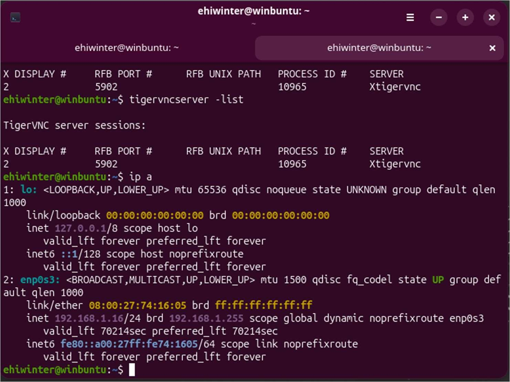

---

### 2.4. Étape 4 — Création du tunnel SSH RDP depuis Windows 10
Depuis l'invite de commandes Windows (`C:\Users\HP>`), nous redirigeons le port local `3390` du poste Windows vers le port `3389` de la machine Ubuntu. Le port local `3390` est retenu plutôt que `3389` afin d'éviter tout conflit avec le service Bureau à distance intégré à Windows.

```cmd
ssh -L 3390:127.0.0.1:3389 ehiwinter@192.168.1.16
```

* **Figure 1.4 : Ouverture du tunnel SSH (port local `3390` vers port `3389` d'Ubuntu) depuis Windows 10**  
  *Ce que montre cette capture :* La connexion SSH s'établit sans mot de passe grâce aux clés RSA configurées précédemment ; le tunnel reste actif tant que cette fenêtre est ouverte.  
  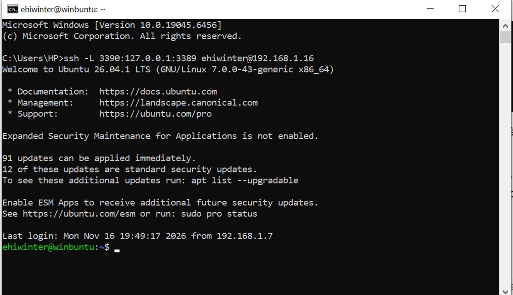

---

### 2.5. Étape 5 — Connexion via le client Bureau à distance Windows (`mstsc`)
Nous ouvrons l'application native « Connexion Bureau à distance » (`mstsc`) sous Windows 10 et renseignons l'entrée locale du tunnel : `127.0.0.1:3390`.

* **Figure 1.5 : Interface d'authentification `xrdp` (`Login to winbuntu`, session `Xorg`) via `127.0.0.1:3390`**  
  *Ce que montre cette capture :* Le client RDP de Windows traverse le tunnel SSH chiffré et affiche la mire de connexion bleue de `xrdp` sur `winbuntu` avec le module de session `Xorg`.  
  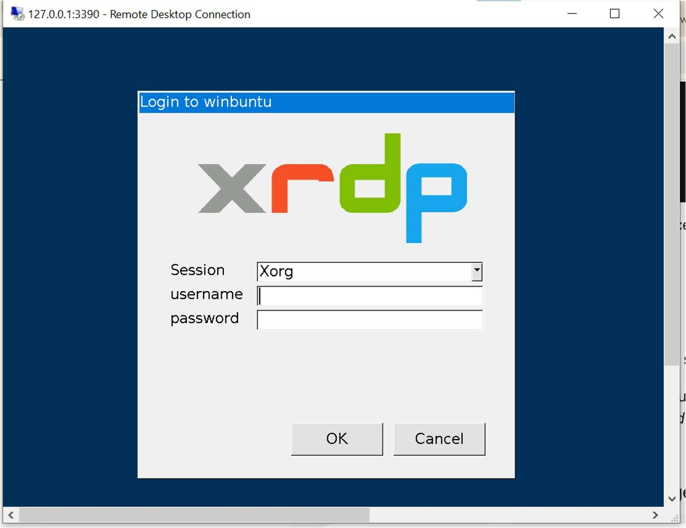

---

### 2.6. Étape 6 — Vérification de la configuration Bureau à distance côté Windows 10
Nous vérifions également les paramètres de Bureau à distance dans Windows 10 (`Paramètres > Système > Bureau à distance`) afin de contrôler l'état d'accès entrant et les comptes autorisés sur le poste client.

* **Figure 1.6 : Paramètres Windows « Remote Desktop » désactivés (`Off`)**  
  *Ce que montre cette capture :* L'option « Enable Remote Desktop » est sur `Off` : le PC Windows agit uniquement comme client et n'autorise aucune prise de contrôle entrante.  
  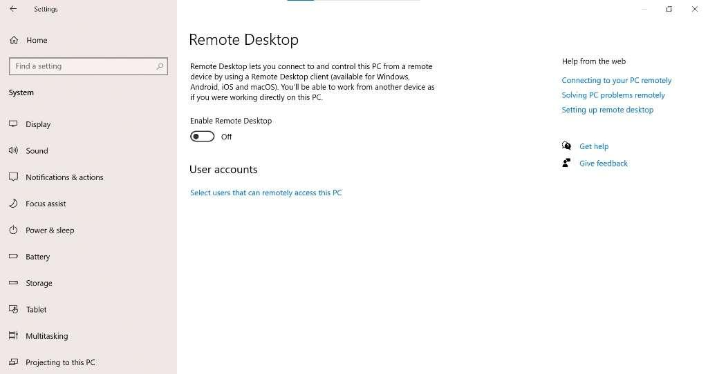

* **Figure 1.7 : Liste des utilisateurs autorisés au Bureau à distance (`Remote Desktop Users`)**  
  *Ce que montre cette capture :* Le compte administrateur `HP` dispose par défaut des privilèges d'accès à distance sur la machine.  
  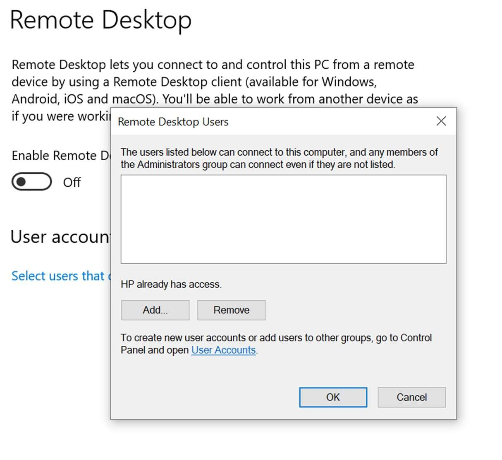

* **Figure 1.8 : Fenêtre d'ajout d'utilisateurs autorisés (`Select Users` sur `DESKTOP-KOLK3MG`)**  
  *Ce que montre cette capture :* Interface Windows permettant de rechercher et d'ajouter des comptes utilisateurs autorisés.  
  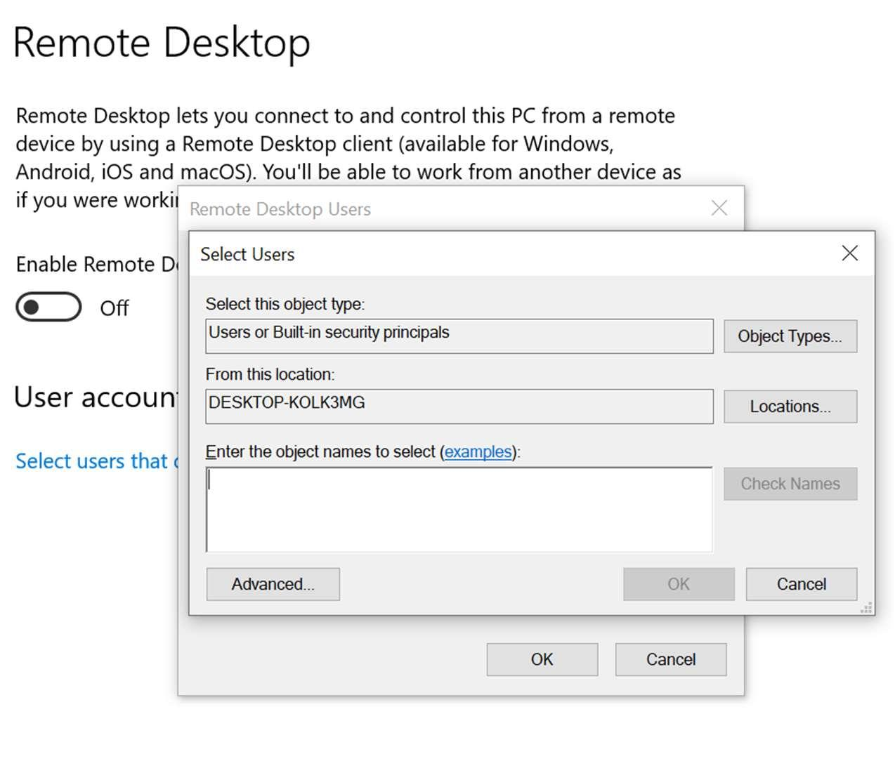

---

## 3. Partie 2 : Bureau à distance VNC avec TigerVNC, XFCE4 et Tunnel SSH

Contrairement à `xrdp`, TigerVNC génère un affichage virtuel X11 indépendant identifié par un numéro d'écran `:N` associé au port TCP `5900 + N`. En démarrant l'écran `:2`, le serveur écoute sur le port TCP `5902`.

### 3.1. Étape 7 — Installation de TigerVNC et vérification des binaires
Nous installons les paquets `tigervnc-standalone-server` et `tigervnc-common` sur Ubuntu (qui intègrent également `tigervnc-tools` et l'utilitaire `vncpasswd`).

```bash
sudo apt update
sudo apt install tigervnc-standalone-server tigervnc-common -y
dpkg -l | grep tigervnc
which tigervncserver vncserver
```

* **Figure 2.1 : Installation de `tigervnc-standalone-server`, `tigervnc-common` et `tigervnc-tools` (`v1.15.0`)**  
  *Ce que montre cette capture :* Installation réussie des paquets serveur et utilitaires TigerVNC depuis les dépôts officiels Ubuntu.  
  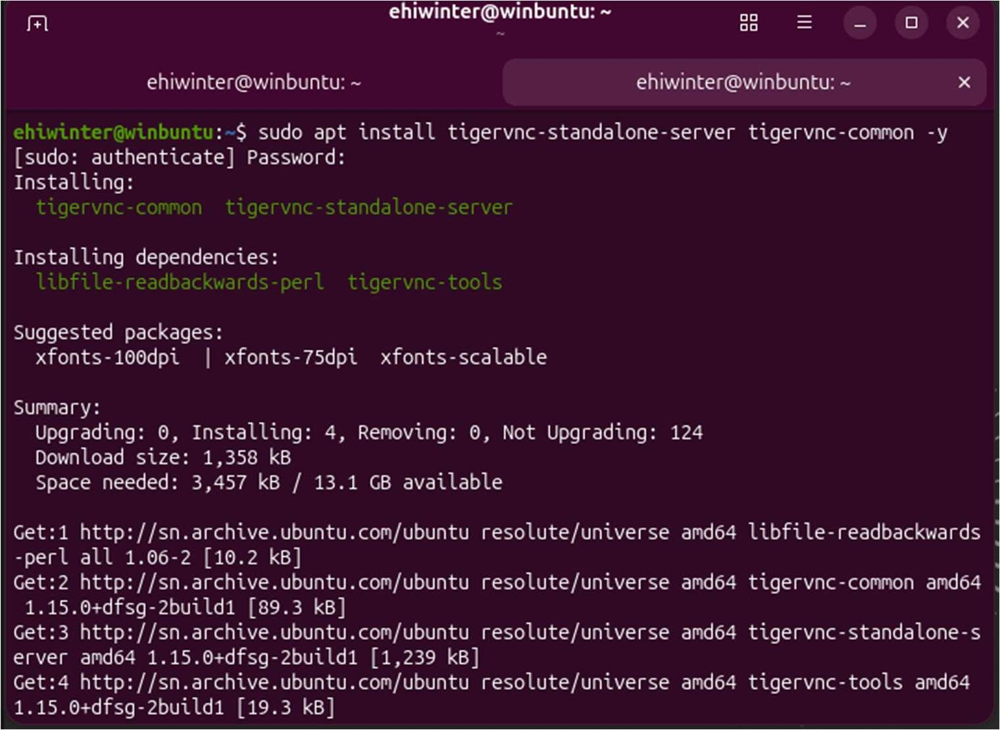

* **Figure 2.2 : Vérification des paquets installés (`dpkg -l`) et des exécutables (`/usr/bin/tigervncserver`)**  
  *Ce que montre cette capture :* Confirmation que la version `1.15.0+dfsg-2build1` est installée et que les commandes `tigervncserver` et `vncserver` sont disponibles.  
  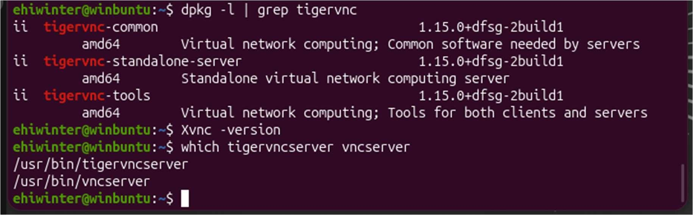

* **Figure 2.3 : Exécution de `sudo tigervncserver -version`**  
  *Ce que montre cette capture :* Sur Ubuntu 26.04 avec TigerVNC 1.15, le script wrapper `tigervncserver -version` n'affiche pas de bannière en sortie standard ; l'état installé est validé par `dpkg -l`.  
  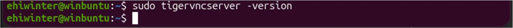

---

### 3.2. Étape 8 — Installation de l'environnement de bureau léger XFCE4 et `dbus-x11`
Le bureau GNOME d'Ubuntu étant gourmand et sujet aux incompatibilités Wayland dans une session VNC, nous installons l'environnement graphique léger **XFCE4**, ses plugins (`xfce4-goodies`) ainsi que `dbus-x11` pour assurer la communication inter-processus de la session.

```bash
sudo apt update
sudo apt install -y xfce4 xfce4-goodies dbus-x11
```

* **Figure 2.4 : Installation des paquets `xfce4`, `xfce4-goodies` et `dbus-x11` sur `winbuntu`**  
  *Ce que montre cette capture :* Déploiement de l'environnement graphique XFCE4 et de ses dépendances sur le serveur Ubuntu.  
  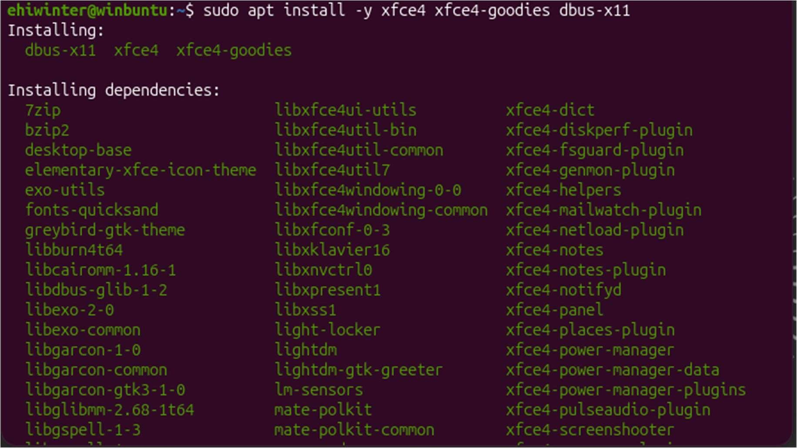

* **Figure 2.5 : Sélection du gestionnaire d'affichage par défaut (`gdm3` conservé)**  
  *Ce que montre cette capture :* Lors de la configuration de `lightdm` installé en dépendance, nous conservons `gdm3` afin de ne pas modifier l'écran de connexion natif d'Ubuntu.  
  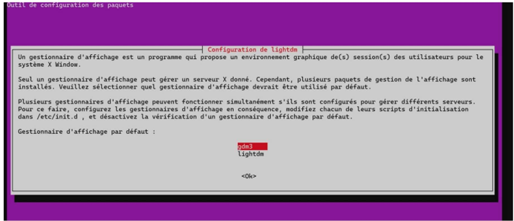

---

### 3.3. Étape 9 — Configuration de TigerVNC (`config`) et du mot de passe VNC (`vncpasswd`)
Nous créons le répertoire de configuration et définissons les paramètres par défaut dans `~/.vnc/config` : session XFCE, écoute restreinte à `localhost=yes` (pour obliger l'usage du tunnel SSH), résolution `1920x1080` et profondeur de couleur 24 bits. Nous définissons ensuite le mot de passe d'accès VNC avec `vncpasswd`.

```bash
mkdir -p ~/.vnc ~/.config/tigervnc
nano ~/.vnc/config
vncpasswd
```

* **Figure 2.6 : Création du dossier `~/.vnc` et édition du fichier de configuration**  
  *Ce que montre cette capture :* Préparation de l'arborescence de configuration utilisateur pour TigerVNC.  
  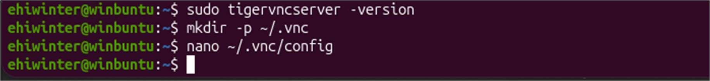

* **Figure 2.7 : Paramètres enregistrés dans `~/.vnc/config` (`session=xfce`, `localhost=yes`, `1920x1080`, `depth=24`)**  
  *Ce que montre cette capture :* Le paramètre `localhost=yes` garantit que le serveur VNC n'acceptera aucune connexion directe depuis le réseau extérieur.  
  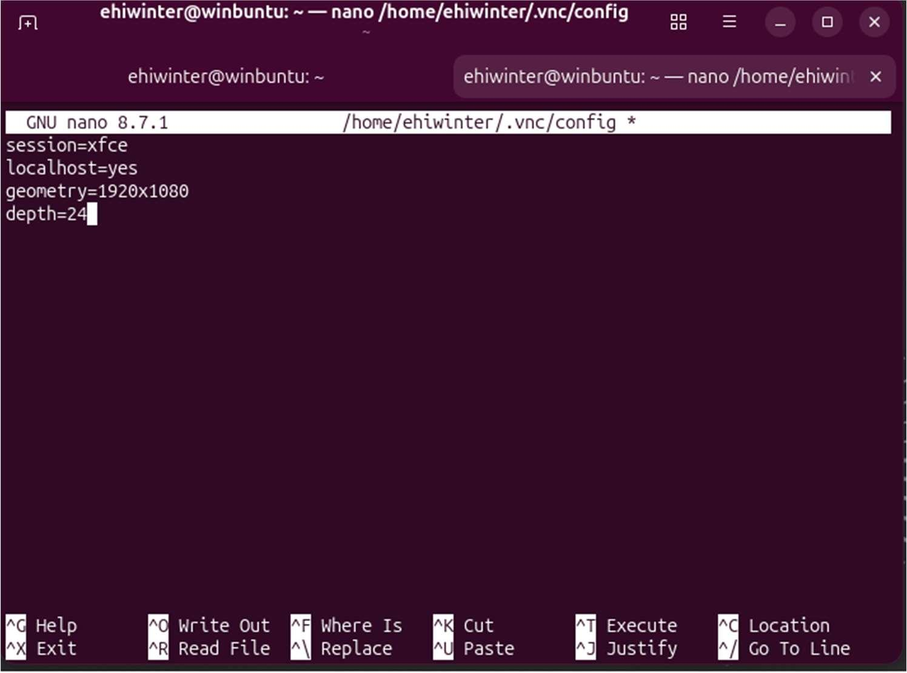

* **Figure 2.8 : Définition du mot de passe d'authentification VNC via `vncpasswd`**  
  *Ce que montre cette capture :* Création du mot de passe principal VNC (et du mot de passe en lecture seule) stocké sous forme chiffrée.  
  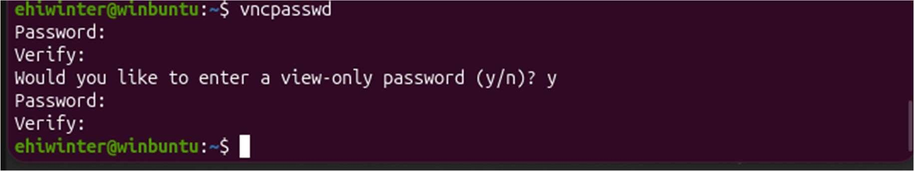

---

### 3.4. Étape 10 — Configuration du script de démarrage `xstartup` (X11 & D-Bus)
Le script exécutable `xstartup` indique à TigerVNC comment démarrer la session XFCE. Il supprime les variables d'environnement héritées de Wayland (`unset WAYLAND_DISPLAY`), force l'utilisation du serveur X11 (`XDG_SESSION_TYPE=x11`, `GDK_BACKEND=x11`) et lance XFCE à travers `dbus-launch`.

```bash
cat << 'EOF' > ~/.config/tigervnc/xstartup
#!/bin/sh
unset SESSION_MANAGER
unset DBUS_SESSION_BUS_ADDRESS
unset WAYLAND_DISPLAY
export XDG_SESSION_TYPE=x11
export GDK_BACKEND=x11
export XKL_CFG_DIR=/etc/X11/xkb
[ -r $HOME/.Xresources ] && xrdb $HOME/.Xresources
exec dbus-launch --exit-with-session startxfce4
EOF
cp ~/.config/tigervnc/xstartup ~/.vnc/xstartup
chmod +x ~/.config/tigervnc/xstartup ~/.vnc/xstartup
```

* **Figure 2.9 : Contenu final vérifié de `~/.config/tigervnc/xstartup` sous `nano`**  
  *Ce que montre cette capture :* Le script nettoie l'environnement Wayland et démarre proprement `startxfce4` via `dbus-launch`.  
  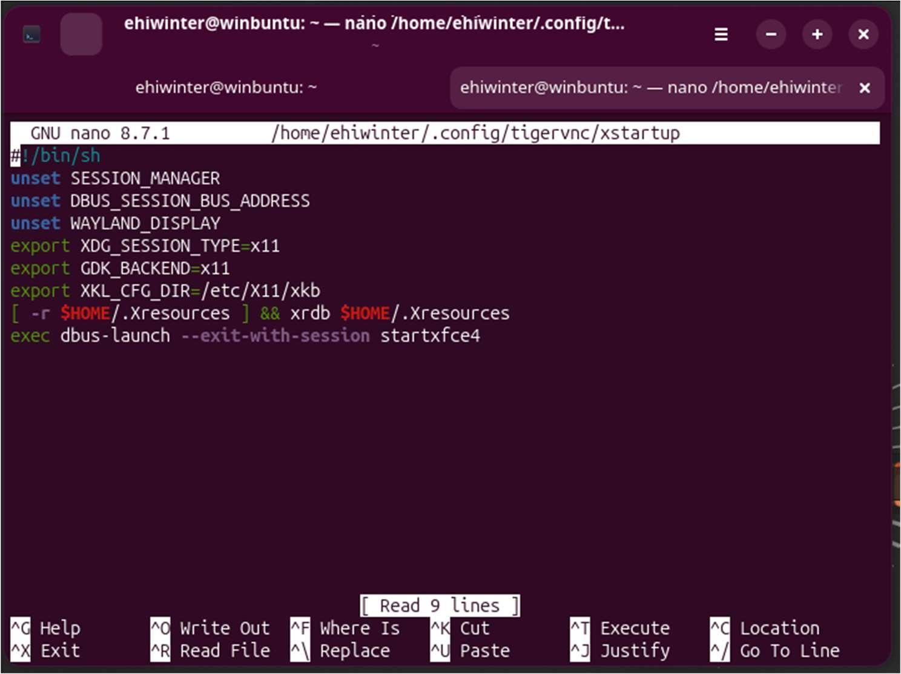

---

### 3.5. Étape 11 — Lancement du serveur TigerVNC (`:2`) et contrôle du port 5902
Nous démarrons l'instance VNC sur l'affichage `:2` (port TCP `5902`) en mode local uniquement (`-localhost yes`) et vérifions l'état d'écoute avec `ss -tlnp`.

```bash
tigervncserver :2 -localhost yes -xstartup ~/.config/tigervnc/xstartup
tigervncserver -list
ss -tlnp | grep 5902
```

* **Figure 2.10 : Démarrage réussi du serveur `Xtigervnc` sur `winbuntu:2` (port `5902`)**  
  *Ce que montre cette capture :* Le serveur VNC démarre sans erreur sur l'affichage `:2` et charge la session XFCE.  
  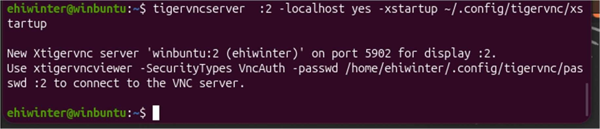

* **Figure 2.11 : Vérification de l'écoute exclusive sur l'interface locale `127.0.0.1:5902`**  
  *Ce que montre cette capture :* La sortie de `ss -tlnp | grep 5902` confirme que `Xtigervnc` écoute uniquement sur `127.0.0.1:5902` et `[::1]:5902`, obligeant le passage par le tunnel SSH.  
  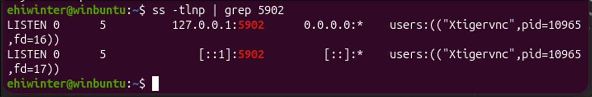

---

### 3.6. Étapes 12 et 13 — Tunnel SSH depuis Windows 10 et connexion TigerVNC Viewer
Depuis un terminal PowerShell ou CMD sur Windows 10, nous ouvrons le tunnel SSH reliant le port local `5902` de Windows au port `5902` d'Ubuntu, puis nous lançons le client TigerVNC Viewer sur l'adresse `localhost:5902`.

```powershell
ssh -L 5902:127.0.0.1:5902 ehiwinter@192.168.1.16
```

* **Figure 2.12 : Saisie de l'adresse du tunnel `localhost:5902` dans TigerVNC Viewer sur Windows 10**  
  *Ce que montre cette capture :* Le client graphique TigerVNC Viewer se connecte à l'entrée locale du tunnel SSH (`localhost:5902`).  
  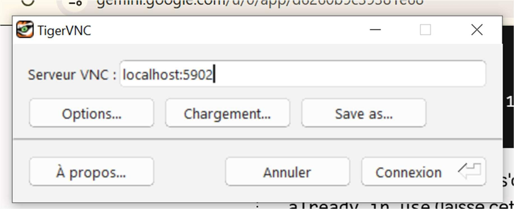

* **Figure 2.13 : Affichage complet du bureau graphique XFCE d'Ubuntu dans TigerVNC Viewer sur Windows 10**  
  *Ce que montre cette capture :* Validation finale : le bureau XFCE4 complet (barre supérieure *Applications*, icônes système et dock inférieur) s'affiche et répond normalement à la souris et au clavier à travers le tunnel SSH.  
  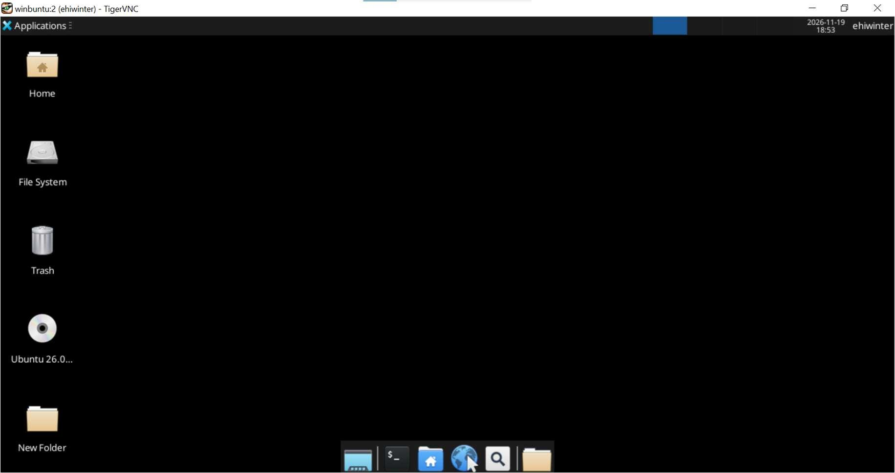

---

## 4. Problèmes Rencontrés, Diagnostic et Solutions Apportées

Durant la réalisation de ce TP, quatre incidents techniques concrets ont été rencontrés. L'analyse des messages d'erreur, des ports réseau (`ss -tlnp`) et des journaux TigerVNC (`~/.config/tigervnc/winbuntu:2.log`) a permis de les résoudre méthodiquement :

### 4.1. Incident 1 : `bind [127.0.0.1]:5902: Address already in use`
* **Symptôme :** Lors de l'exécution de `ssh -L 5902:127.0.0.1:5902 ehiwinter@192.168.1.16`, SSH affiche `cannot listen to port: 5902`.
* **Cause :** La commande avait été tapée dans un terminal déjà connecté en SSH sur Ubuntu (`ehiwinter@winbuntu:~$`), où `Xtigervnc` occupait déjà le port local `5902`.
* **Solution :** Quitter la session distante (`exit`) pour revenir sur le terminal local Windows 10 (`PS C:\Users\HP>`) avant de lancer le tunnel SSH.
* **Figure 3.1 : Erreur `Address already in use` due au lancement du tunnel depuis la session Ubuntu**  
  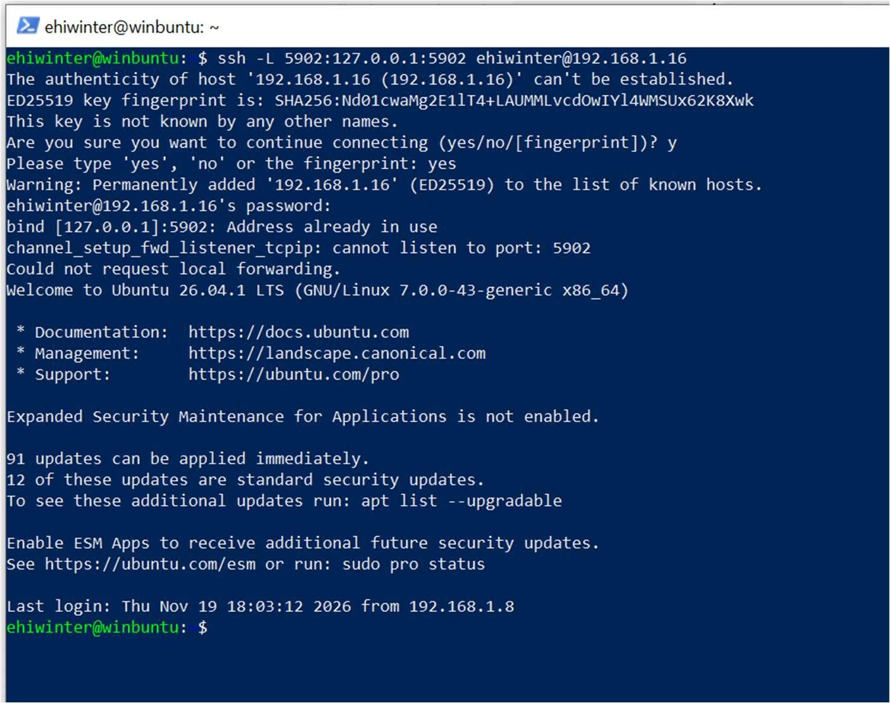

### 4.2. Incident 2 : `Unable to connect to socket... (10061)` dans TigerVNC Viewer
* **Symptôme :** TigerVNC Viewer affiche une boîte d'erreur indiquant que l'ordinateur cible a expressément refusé la connexion sur `localhost:5902`.
* **Cause :** Le port local `5902` n'était pas en écoute sur Windows 10 car le tunnel SSH n'avait pas encore été ouvert côté client.
* **Solution :** Lancer le tunnel SSH depuis PowerShell Windows (`ssh -L 5902:127.0.0.1:5902 ehiwinter@192.168.1.16`) et garder la fenêtre ouverte avant de cliquer sur *Connexion*.
* **Figure 3.2 : Erreur de connexion refusée (code `10061`) lorsque le tunnel SSH est fermé côté Windows**  
  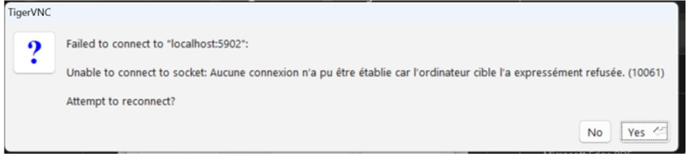

### 4.3. Incident 3 : `Can't exec '/home/ehiwinter/.config/tigervnc/xstartup': Permission denied`
* **Symptôme :** Le démarrage de `tigervncserver :2` échoue immédiatement avec `exited with status 1`.
* **Cause :** TigerVNC 1.15 recherche par défaut le script dans `~/.config/tigervnc/xstartup` et exige que le fichier possède les droits d'exécution (`+x`).
* **Solution :** Copier le fichier `xstartup` dans `~/.config/tigervnc/xstartup` et appliquer `chmod +x ~/.config/tigervnc/xstartup`.
* **Figure 3.3 : Journal d'erreur TigerVNC signalant `Permission denied` sur `xstartup`**  
  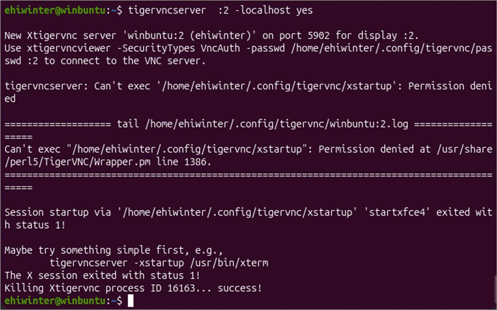

### 4.4. Incident 4 : Écran noir après authentification dans TigerVNC Viewer
* **Symptôme :** La fenêtre `winbuntu:2 (ehiwinter) - TigerVNC` s'ouvrait avec uniquement le menu presse-papiers, mais l'écran restait noir sans bureau XFCE.
* **Cause :** Absence initiale d'un script `xstartup` nettoyant la variable `WAYLAND_DISPLAY` et démarrant XFCE via `dbus-launch`.
* **Solution :** Arrêter la session avec `tigervncserver -kill :2`, rédiger le script `xstartup` complet (`unset WAYLAND_DISPLAY`, `export XDG_SESSION_TYPE=x11`, `exec dbus-launch --exit-with-session startxfce4`), puis relancer le serveur.
* **Figure 3.4 : Écran noir observé dans TigerVNC avant la configuration complète de `xstartup`**  
  
* **Figure 3.5 : Arrêt propre de l'ancienne session VNC via `tigervncserver -kill :2`**  
  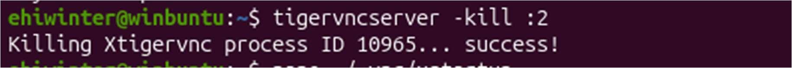

---

## 5. Conclusion Générale

Ce travail pratique nous a permis de déployer, sécuriser et valider deux solutions professionnelles d'administration graphique à distance entre un poste client Windows 10 et un serveur Ubuntu 26.04 LTS :

* **Double protocole graphique (RDP & VNC) :** Configuration opérationnelle de `xrdp` sur le port `3389` pour les clients Windows natifs (`mstsc`) et de `TigerVNC + XFCE4` sur le port `5902` pour une session graphique virtuelle légère et réactive.
* **Sécurité renforcée par tunnel SSH :** Grâce à l'écoute locale exclusive (`localhost=yes` / `127.0.0.1`) et aux redirections de ports locaux (`ssh -L 3390:127.0.0.1:3389` et `ssh -L 5902:127.0.0.1:5902`), l'ensemble des échanges graphiques et des identifiants est chiffré de bout en bout.
* **Maîtrise du diagnostic système et réseau :** L'utilisation conjointe de `ss -tlnp` pour vérifier les sockets en écoute et l'analyse des logs TigerVNC ont permis de résoudre efficacement les problèmes de redirection de ports, de permissions et d'environnement graphique X11/Wayland.
